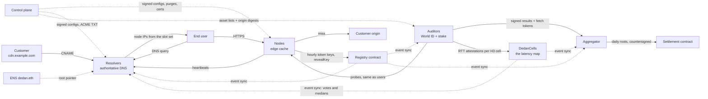
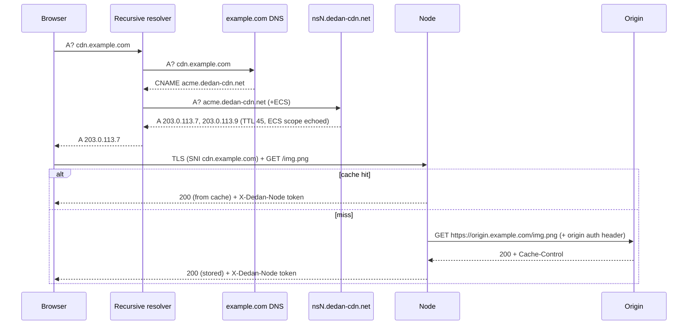
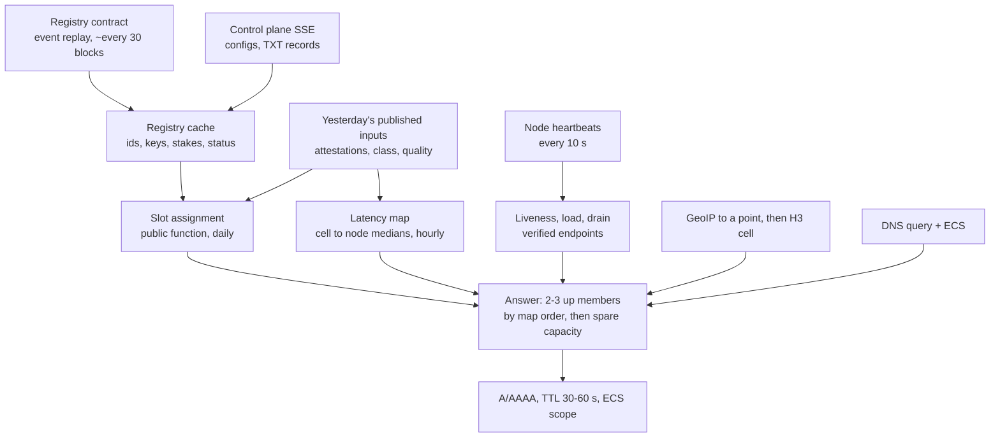

# Dedan — Decentralized CDN Architecture (v3.2)

Sep 26, 2026 · @Ege · v3.1: ENSv2 names, records and Enhanced Access Control as the identity layer. v3.2: cells as ENS names, the latency map kept on chain by `DedanCells`. Appendix A lists every change from v1, v2 and v3 with the reason. Appendix B lists the attacks the design was checked against. `FIX.md` lists what the 2026-09-26 audit of the build against this document found and how each item was settled.

## 1. Overview and design principles

Dedan is a CDN whose edge nodes are independently operated, registered in an on-chain registry, routed by authoritative DNS, and paid from an on-chain settlement contract. Customers point a subdomain at Dedan with a CNAME; end users connect directly to the nearest node.

One fact drives the design: third parties can measure a node's quality (uptime, throughput, correctness, location), but nobody except the node can see its consumption (requests, bytes). Every economic rule follows from that.

- **Money = public assignment × audited quality.** A public, deterministic function assigns nodes to customer slots from on-chain and signed data; auditors measure how well each slot was served. Nothing a node or a resolver reports about itself touches money.
- Consumption is managed by routing (per-domain rate caps, load steering inside a slot set), never accounted for.
- **Location is measured, never declared.** Verified humans attest round trips to nodes from their own location cells, to the cells contract (`DedanCells`), which keeps the medians; that map decides which nodes an account gets and which one a client is sent to. A node is where the humans measure it to be.
- **A node is an ENS name, and every permission is a role.** Nodes are subnames of `dedan.eth` in Dedan's ENSv2 registry; their endpoint and config are the name's records; who may register, attest, probe, sign or slash is an Enhanced Access Control role on that registry, granted to World ID-verified humans or by governance.
- Probes are indistinguishable from real users: same paths users fetch, same client behaviour, no marker. A node cannot favour auditors because it cannot find them.
- Every probe result carries proof that the fetch happened (a token only the node could have minted), so auditors cannot invent results either.
- Nothing on the request path queries the blockchain; the registry and account configs are synced and cached.
- Every message between components is a signed envelope whose signer resolves to a registry entry with a stake, or to an account key with a balance.
- Secrets have a bounded audience: origin credentials reach only the nodes assigned to the account, encrypted to each node's key.



Solid arrows are the live path; dotted arrows are periodic syncs or streams.

## 2. Actors and components

Nine components, each with one job.

| Component | Runs where | Job | Reads | Writes |
|---|---|---|---|---|
| Dedan registry (`DedanRegistry`, an ENSv2 `PermissionedRegistry`) | World Chain | Identity root: the `dedan.eth` subname registry with Dedan's rules. Node names as tokens, roles as EAC bitmaps, stakes, World ID checks, `revealKey` as events (one per node and hour, after the hour), cell names with itself as their subregistry | World ID verifier | `registerOperator/Attester/Auditor`, `registerNode`, `grantRoles` (owner → signer keys), unbond, withdraw (which also removes the node from its cells and clears its records), `revealKey`; suspend and slash by governance |
| Cells contract (`DedanCells`) | World Chain | The latency map on chain: nodes join cells (`<h3 hex>.dedan.eth`, resolution 2), humans `attest(cell, batch)` once a minute per cell, one vote per human per node per cell in per-day histograms; the medians are the records of `<label>.<cell>.dedan.eth` | The registry (roles, owners, activity) | `join`, `leave`, `attest`; `Joined`, `Left`, `Attested` events |
| Settlement contract | World Chain | Customer balances, daily cumulative payout and bill roots, dispute window, withdrawal delay, signer bonds, the price table per tier | Countersigned roots, the registrar's account signatures | createAccount (with the registrar's signature), deposit, request/execute withdraw, claim, publishRoot (bonded signers only), voidRoot |
| ENSv2 tree | World Chain (Dedan's own deployment of the ENSv2 contracts; bridged to canonical L1 `dedan.eth` once ENSv2 reaches mainnet) | Root → `eth` → `dedan` registries, the node resolver (`DedanResolver`: `addr`, `text`, DNS records, `multicall`), the Universal Resolver every client resolves through | — | Governance registers `eth` and `dedan`; node owners write their records |
| Node | Operator hardware, anywhere; `<label>.dedan.eth` | Serve HTTPS for assigned accounts, cache, fetch from origin, mint fetch tokens | Configs, purges, sealed origin secrets, issued certificates, its own ENS records | Heartbeats, CSRs, hourly `revealKey` on chain; its operator writes the records |
| Resolver | 3–5 operators (`ROLE_RESOLVER_OPERATOR`, permissioned in v1) | Authoritative DNS for `dedan-cdn.net`; answer from the public slot sets ordered by the latency map; serve ACME TXT records | Registry events, ENS records through the Universal Resolver, configs, heartbeats, GeoIP | DNS answers |
| Auditor | World ID–verified person, anywhere (`ROLE_ATTESTER`; `ROLE_AUDITOR` with stake) | Two jobs: attest round trips to the members of their own location cell, to `DedanCells` (the latency map), and act as a synthetic user on assigned probes measuring availability, integrity, throughput and resolver conformance | Registry events, public configs, asset lists, origin digests | `attest` transactions and signed probe results, both with fetch tokens |
| Aggregator | Off-chain; one operator plus one independent countersigner in v1 | Deterministic scoring: latency map, slot assignment, quality, SLA multipliers, bills, payouts, evidence | Probe results and asset samples from auditors; attestations, key reveals, names, roles and stakes from the chain; price table | Inputs to IPFS, daily roots on-chain, submission receipts |
| Control plane | API + CLI (web UI later) | Relay the configs customers sign with their account keys; sign account registrations as the registrar; verify domains; run ACME orders for nodes; relay purges; publish asset lists and origin digests | Account keys and balances on chain, origins | Account registrations, relayed configs and purges, TXT records, certificates, digests, SSE stream with replay |

Trust, from most to least: settlement contract (code) → auditors (World ID + stake, statistically cross-checked, results carry fetch proofs) → nodes (stake, probed) → resolvers (stake; no money power: they answer from a set anyone can recompute, and auditors check that they do) → control plane (relays and orders; everything it emits is verifiable against an account key or its published key) → customers (prepaid, signed configs) → end users (untrusted).

## 3. Naming

Two name systems: the registry contract holds identity and trust, ordinary DNS carries traffic. ENS is a human-readable root pointer, not a runtime dependency. Browsers cannot resolve `.eth`, so Dedan owns a real ICANN domain, `dedan-cdn.net`.

### Identity (ENSv2 on World Chain)

Dedan deploys the ENSv2 contracts on World Chain: a root registry, an `eth` registry and, under it, `DedanRegistry`, the `dedan` subname registry that carries Dedan's rules. The tree mirrors canonical ENS so the names read `<label>.dedan.eth` and carry over unchanged when canonical L1 `dedan.eth` points at this registry; until then they are not canonical `.eth` names and nothing outside Dedan resolves them.

| Name / record | Owner | Content |
|---|---|---|
| `<label>.dedan.eth` | The node operator (an ERC-1155 token in `DedanRegistry`) | The node. Registration needs `ROLE_NODE_OPERATOR` and the node stake; the token carries the operator's roles and the stake follows the token |
| `<cell>.dedan.eth` (the H3 index in hex, e.g. `821faffffffffff.dedan.eth`) | `DedanCells`, registered on the cell's first member | A cell: a resolution-2 H3 region about 300 km across. Its subregistry is `DedanRegistry` itself, so every node name resolves under it too. Records: `dedan.nodes` (the members), `dedan.latency.<label>` and `dedan.votes.<label>` (the medians on chain, §6), `dedan.cell` |
| `<label>.<cell>.dedan.eth` | The same token as `<label>.dedan.eth` (no new token; the registry entry is shared) | The node inside a cell it joined (`DedanCells.join`): `dedan.latency` and `dedan.votes` are the cell's median for it, `dedan.cell` and `dedan.node` name both, every other key answers the node's own records. A cell the node never joined answers nothing |
| `addr(60)` on the name | Operator | The payout address the settlement leaves are keyed by |
| DNS A / AAAA records on the name (ENSIP-6) | Operator | The node's endpoint. Changing the IP is one `setDNSRecords` write; the resolvers pick it up within a minute |
| `text` records `dedan.class`, `dedan.location`, `dedan.port`, `dedan.enckey`, `dedan.version` | Operator | Declared class, approximate location (cold start only), port, x25519 key, software version |
| `ROLE_NODE_SIGNER` on the name's resource | Granted by the operator, up to 15 keys | The hot keys that sign envelopes, heartbeats and `revealKey` |
| `ROLE_NODE_OPERATOR`, `ROLE_ATTESTER`, `ROLE_AUDITOR` on the human's own resource | Granted by `DedanRegistry` after a World ID proof (one nullifier per action) | May register nodes; may attest; may run assigned probes (with the auditor stake) |
| `ROLE_RESOLVER_OPERATOR`, `ROLE_SUSPEND`, `ROLE_SLASH`, `ROLE_CONFIGURE` on the root resource | Governance | NS operators; suspension and slashing on published evidence; parameters |

Roles are ENSv2 Enhanced Access Control bitmaps, one nybble per role, with the admin role in the upper half of the word. EAC counts assignees per role in that nybble, fifteen at most per resource, so the roles a whole population holds are granted on a per-human resource (`keccak256("dedan:human" ‖ account)`), one holder each, while node-scoped and governance roles sit where ENS puts them. A name that is removed bumps its EAC version, so no old grant survives a re-registration. Every grant and revoke is an `EACRolesChanged` event, which is how resolvers, auditors and the aggregator learn who may do what; nothing on a request path reads the chain.

Operational metadata that changes often (classes, software version, drain flag, load) lives in the node's signed **heartbeat** (§5). The endpoint does not: it is the name's DNS record, written by the operator, verified by the resolvers' endpoint challenge before it is answered.

### Traffic (DNS)

| Name | Type | Served by | Purpose |
|---|---|---|---|
| `dedan-cdn.net` | Zone | Registrar delegates to `ns1..nsN.dedan-cdn.net` with glue; listed on the Public Suffix List (§10) | Delegation root |
| `nsN.dedan-cdn.net` | A/AAAA glue | Registrar | One per resolver operator |
| `<account>.dedan-cdn.net` | A/AAAA, TTL 30–60 s | Resolvers | CNAME target; answer = 2–3 node IPs from the account's slot set, ordered by the latency map for the client's cell |
| `_acme-challenge.<account>.dedan-cdn.net` | TXT, TTL 60 s | Resolvers, from control-plane-signed records | ACME DNS-01 for per-node customer certificates |
| `<label>.node.dedan-cdn.net` | A/AAAA | Resolvers, from the name's ENS DNS records, after the endpoint challenge | Direct node address: class throughput blob, entry audit, endpoint challenge |
| `_acme-challenge.<label>.node.dedan-cdn.net` | TXT | Resolvers | ACME DNS-01 for the node's own name |

### Customer records

| Record | Value | Required |
|---|---|---|
| `cdn.example.com` | `CNAME <account>.dedan-cdn.net` | Yes (default mode) |
| `_acme-challenge.cdn.example.com` | `CNAME _acme-challenge.<account>.dedan-cdn.net` | Yes for managed TLS |
| `example.com` CAA | `0 issue "letsencrypt.org; accounturi=<Dedan's ACME account URL>"` | Strongly recommended (§10); onboarding checks that CAA at least permits the CAs in use |
| `cdn.example.com` | `NS ns1..nsN.dedan-cdn.net` | Alternative: subdomain delegation instead of CNAME |

The CNAME target is unique per account, so the CNAME itself proves control of the hostname: resolvers and nodes accept a hostname for an account only while `cdn.example.com` resolves to `<that account>.dedan-cdn.net`, checked at onboarding and re-checked hourly by each of them, not only by the control plane. Apex domains use a subdomain, ALIAS/ANAME, or NS delegation.

## 4. Request path

A request costs one DNS resolution (mostly cached by recursives) and one direct HTTPS connection to a node. Dedan controls only the last DNS hop and the node.



### The resolver's decision (steps 4–5)

1. Parse the query name: label `acme` → account config (active, tier, verified hostnames).
2. Locate the client: EDNS Client Subnet if present, else the recursive resolver's IP, via GeoIP to a point, snapped to an H3 cell (resolution 2, about 300 km). Echo the ECS option with a scope in the answer (Google Public DNS stops sending ECS otherwise; Cloudflare never sends it, so the fallback matters).
3. Take the account's **slot set** (§6): the `S` nodes assigned to this account today by the public assignment function, and keep the members that are up (fresh heartbeat, not draining).
4. Order them by the latency map for the client's cell (§6): the median round trip verified humans measured from that cell, ring-searching neighbouring cells until enough humans have measured. Return 2–3; members within 20 ms of each other are ordered by self-reported spare capacity. TTL 30–60 s.
5. Cold start: when no covered cell exists within three rings, order by great-circle distance from the client point to each member's declared approximate location (`dedan.location`; ordering by the map's own estimate, the centroid of the cells where the node measures best, is a later refinement). That declared location never touches money.
6. Nothing is logged for settlement. Counters exist only for the operator's own monitoring.

### The node's decision (step 7)

1. Match SNI/Host to a hostname of an account it is assigned to; unknown SNI → no certificate (handshake fails); unknown Host → 421.
2. Cache key = account generation ‖ host ‖ path ‖ query (normalised per cache rules) ‖ selected Vary values.
3. Hit: serve; honour `Cache-Control`, revalidate with ETag/Last-Modified when stale.
4. Miss: single-flight fetch from the account's declared origin with the origin auth header; store per origin `Cache-Control` (or the default TTL from cache rules); cap object size; serve.
5. Add the fetch token header to every response (§7) and enforce the account's per-domain rate cap for its class.

The origin URL is always explicit in the account config. The node cannot fetch from `cdn.example.com` because that name resolves back to the CDN.

## 5. Node internals

A node is one Rust binary built on Pingora: a reverse proxy with an HTTP cache, a config stream client, a certificate loop, and a heartbeat loop. One binary, one config file, one key file, shipped as one container image.

| Module | Responsibility | Notes |
|---|---|---|
| Listener | HTTP/1.1 and HTTP/2 on 80/443, per-SNI certificate selection | OpenSSL backend with Pingora's `certificate_callback`; certificates chosen from an in-memory store swapped without restart. HTTP/3 is not in Pingora yet (off) |
| Router (`ProxyHttp`) | SNI/Host → account → origin, class, generation | Config table updated from the control-plane stream; 421 default |
| Cache | `pingora-cache` with a disk `Storage` (file per key + metadata, atomic rename, streaming writes), cache lock = single-flight, stale-while-revalidate, stale-if-error up to 24 h, LRU eviction | OS page cache is the hot tier in v1; a memory tier only if measured. pingora-cache's API is declared volatile, so the version is pinned |
| Origin fetcher | Connection pooling to origins, origin auth header from the sealed secret, honours `Cache-Control`, `ETag`, `Vary`, object size cap | Secret decrypted with the node's x25519 key, held in memory only |
| Token minter | Adds `X-Dedan-Node: <label>.<minute>.<net>.<hmac>` to every response, `hmac = HMAC(k_hour, minute ‖ client /24)`, `<net>` = that /24 (or /48) as the node saw it, in hex | One HMAC per response. `k_hour = HMAC(hot key, hour)`: unpredictable without the node's hot key, the same after a restart (the registry takes one reveal per hour), revealed on chain (`revealKey`) after the hour ends (§7); binding the /24 rather than the address keeps attestations publishable |
| Rate cap | Per-account aggregate Mbps cap = the account's class | `pingora-limits`; the node's own counters decide, nobody else sees them |
| Purger | Signed purges: URL → `Storage::purge(key)`; account or prefix → bump the account's generation in the cache key | Purge ids stored to reject replay; prefix purge = whole-account bump in v1 |
| Config client | SSE stream from the control plane with per-account sequence numbers; replays from the last seq on reconnect; full sync every 60 s | Verifies every config against the account key and every hostname's CNAME |
| Certificate loop | Own key per hostname; sends CSRs to the control plane, receives certificates (§10); renews at two thirds of lifetime | The node never holds an ACME account key; the control plane never sees a private key |
| Heartbeat | Every 10 s to every resolver: classes, version, drain flag, load Mbps, connections, CPU | Signed by a `ROLE_NODE_SIGNER` key; resolvers mark a node down after 3 misses. The endpoint is not in it: it is the name's DNS record (§3), verified by challenge (§6) |
| Records | The operator writes the name's records on the ENS resolver: `addr`, `dedan.*` text, DNS A/AAAA, in one `multicall`; the node's hot key calls `revealKey` on chain after every hour | The node holds no ENS key; a record change is an operator transaction |
| Blob endpoint | `<label>.node.dedan-cdn.net/.well-known/dedan/blob/<n>` serves n MB of deterministic bytes; `/.well-known/dedan/challenge/<nonce>` returns the nonce signed by a signer key | Class throughput probes, entry audit, endpoint ownership |

Rules the node enforces on its own behalf:

- Rate-cap an account at what its class pays for; the node's own counters decide.
- Reject unknown hosts with 421 rather than proxying blindly.
- Serve stale on origin failure for up to 24 h.
- Drain before shutdown: set the drain flag, keep serving for two TTLs, then stop listening so failed connects get a RST (browsers fall back to the next address immediately on RST, but wait 20–30 s on a silent drop).
- Keep access logs local only, if at all: hashed URLs, client IPs truncated to /24. Nothing is shipped off-box.
- Never persist a decrypted origin secret or an hourly token key beyond its reveal.

## 6. Resolver internals

A resolver is an authoritative DNS server whose answers are computed from the public slot sets, the latency map, live heartbeats and GeoIP. It answers in under 5 ms and never touches the chain on the query path. Built on `hickory-server` with a custom request handler.



### Sync loop

1. Read the deployment (contract addresses, control-plane key, resolver list) once at start.
2. Replay `DedanRegistry` and `DedanCells` events from the last seen block into the identity cache: names, owners, stakes, roles, suspensions, key reveals, cell membership, attestations; keep the block number and its time (the chain's clock, which the map's window follows). Read every node's records through the Universal Resolver (`resolve(name, data)` per ENSIP-10): `addr`, `dedan.*` text, DNS A/AAAA.
3. Take the account configs the control plane relays (a full read every sync): a config counts only with the signature of the account key registered on the Settlement contract and a version above the one held. Read each account's balance and its tier's price from the Settlement contract and stop answering an account whose effective balance (§8) cannot cover four periods at list price. Delegations and control-plane-signed ACME TXT records are M4.
4. Mirror the latency map from the chain's `Attested` events with the contract's own rules (below) and recompute today's slot assignment from yesterday's published quality. Every resolver, auditor and the aggregator hold the contract's map and the same sets from the same chain, without asking the contract; the token and location checks the contract cannot make produce evidence.
5. Re-verify every hostname's CNAME hourly; drop hostnames that no longer point at their account.

### Latency map (the public location function)

Nobody declares where a node is. The map is the state of `DedanCells`, written by verified humans and read by everyone:

- **Cells** are H3 resolution-2 regions, about 300 km across, and ENS names (§3). A node's operator **joins** the node to the cells it serves (its own and the ring around it on the devnet; a continent is about a hundred cells, one batch transaction). Only members of a cell can be attested in it, so a human measures a dozen nodes, not the whole network.
- **Attestations**: the auditor app snaps the device location to its cell and, at most once a minute per cell, sends one `attest(cell, batch)` transaction with a round trip and the fetch token for each member it reached (§7). A human may attest from any cell it is in.
- **Votes**: per human, cell and node the contract keeps one vote, the newest sample; a new sample withdraws the previous one, also when that one sits in yesterday's histogram. A liar has one vote; an honest human refines every minute.
- **Histograms and medians**: votes land in the day's histogram of 32 buckets of 8 ms (the last one open-ended), two storage slots per cell, node and day. The cell's record for a node is the lower-middle median over today's and yesterday's votes, as the bucket midpoint (`DedanCells.median`, the `dedan.latency` text record of `<label>.<cell>.dedan.eth`). Old measurements age out with the days.

```
rank(cell)      = the cell's current members with k votes each, ordered by median           # k = 3 minimum, 5 target
                  (1 on the devnet); a cell without k votes merges the histograms of grid_disk(cell, r) for r = 1..3
location(node)  = centroid of the cells where the node ranks best; the operator's declared approximate location
                  only while the node has no votes at all
```

Resolvers, auditors and the aggregator do not query the contract for every cell: they replay the same rules from the `Attested` events (`core::map::from_votes`) and hold the identical map at any block, which a live test asserts against `median()`. The fetch token inside every attestation (it binds the /24 the node saw, which must geolocate within 250 km of the cell) and the human's World ID are what the *off-chain* checks use: an attestation whose token does not verify, or whose network is far from its cell, is not paid and is evidence for suspension (§7, Appendix B); its vote still counts once, which is why a cell's ranking needs k humans and a single human cannot move a median alone.

### Slot assignment (the public function)

Each account has one **slot set** of `S` nodes, `S` being its node-count tier. The set is computed once a day by a pure function of public data, so anyone can recompute it and nobody decides it:

```
assign(day) :
  seed      = hash(L1 block at 00:00 UTC of day)
  eligible  = registered nodes with status active (not suspended, not unbonding, minimum stake held), class
              conclusive ≥ account class (yesterday's coordinated throughput probe; an inconclusive probe leaves the
              node at its highest conclusive class, 100M when none; never the class a node declares), entry audit
              passed, not on the account's operator denylist (or on its allowlist if one is set), stake ≥ account
              min_node_stake; a node without a map row costs uncovered_rtt everywhere, so measured nodes win
  for a in accounts, in seeded order:
    keep yesterday's members that are still eligible, had quality ≥ 0.9 yesterday, and pass    # sticky
    the same /24 and admission checks as new members (yesterday = the aggregator's published period)
    repeat until |set| = S:
      add the eligible node that most reduces Σ_{covered cells} min_{member} rtt(cell, member)   # greedy k-median
      subject to: at most one node per /24, prefer distinct ASNs within the set                 # no Sybil replication
                  committed capacity of the node (Σ class of its slots) + this class ≤ k × node class   # admission, k = 3
    rotate out at most one kept member per day when a replacement improves the sum by > 10%   # newcomers get in
```

Properties: idle capacity earns nothing (only slots pay); a node cannot raise its share by anything it reports (load, class, uptime and location all come from audits, attestations or the chain); an operator with ten identities on one box gains nothing inside a set (one per /24) and fails the coordinated class probe across sets (§7); a node nobody has measured costs the uncovered-cell penalty everywhere, so it is chosen only when no measured node fits; caches stay warm because sets are sticky; every new (node, account) pair costs one certificate issuance, and stickiness keeps that under the CA's weekly limits (§10).

Answers order the up members of the set by `rank(cell)` for the client's cell and return 2–3; members within 20 ms of each other are ordered by heartbeat spare capacity. That choice affects which member carries more load, never who gets paid, so a node that lies about its load only earns itself more traffic and worse probe results.

### Endpoint verification

A name's DNS record (A and AAAA alike) is answered only after the resolver has fetched `http://<ip>:<port>/.well-known/dedan/challenge/<nonce>` and received the nonce signed by one of the name's signer keys; the signature over a fresh nonce is the proof, so plain HTTP suffices. One endpoint per node; an address two names proved is served for neither until one changes its record. Auditors identify the node that served them from the response token (§7), never from the IP alone.

### Records served

| Query | Answer |
|---|---|
| `<account>.dedan-cdn.net A/AAAA` | 2–3 up members of the slot set, ordered by the latency map for the client's cell |
| `_acme-challenge.<account>.dedan-cdn.net TXT` | Records signed by the control plane for an order it is running (§10); removed after 10 min |
| `<label>.node.dedan-cdn.net A/AAAA` | The name's DNS record from ENS, once challenged |
| `_acme-challenge.<label>.node.dedan-cdn.net TXT` | Control-plane-signed record for the node's own name |
| `nsN.dedan-cdn.net A/AAAA` | The operator's own address |
| `dedan-cdn.net SOA/NS` | Zone metadata; NS = all active resolver operators |

### Multiple operators

Each operator runs the same software with its own key. Recursives spread queries across all NS records, so no single operator sees all traffic, and because answers come from a public set, no operator decides who earns. Auditors check conformance two ways (§7): landing probes through their own recursive resolver (unattributed, catches cheating aimed at real users) and direct queries to each operator's NS (attributed). An operator whose direct answers fall outside the slot sets is suspended by governance on published evidence; persistent violations are slashed. Resolver operators are permissioned by governance in v1 (they are NS records at the registrar); five is the target, three the minimum (§10 explains why the count matters).

## 7. Auditors

Auditors are the only source of the location and quality numbers that money depends on. Each auditor is a World ID–verified person (one human, one account per role) running one app from wherever they are. They produce two kinds of record: **attestations**, opportunistic round-trip measurements from their own location cell, sent to `DedanCells.attest` and kept there as per-day histograms, which are the latency map (§6); and **probe results** from assigned probes that measure quality. Probes are assigned by a verifiable schedule so no auditor picks its targets; probes look like user traffic so nodes cannot favour them; every successful probe and every attestation carries a token so auditors cannot invent them. `registerAttester(proof)` grants `ROLE_ATTESTER` for a World ID proof alone; `registerAuditor(proof, stake)` grants `ROLE_AUDITOR` with the governance minimum stake, which assigned probes need.

**Reaching a specific node without being identifiable**: connect to the node's IP with SNI and Host set to the customer hostname. That is exactly what a user whose recursive resolver returned that IP does.

**What to fetch**: not a fixed list. Each account has an **asset list**: the customer's cacheable asset inventory (from a manifest URL the customer maintains, or crawled by the control plane from the customer's declared entry pages). The control plane fetches a seeded sample of it from the origin every hour and publishes signed digests (decoded body sha256, current and previous, plus origin ETag). Auditors sample from the same list with the schedule seed. A node that wants to serve "probe paths" well must serve the customer's assets well, which is the point.

**Proof of fetch**: every response carries `X-Dedan-Node: <label>.<minute>.<net>.<hmac>`, the HMAC binding the client's /24 as the node saw it, which the token also carries (so an auditor behind NAT reports the network the node saw). After each hour a signer key of the node calls `revealKey(label, hour, k)` on the registry: once per hour, never before the hour ends (a governance flag allows early reveals on the devnet, whose periods are two minutes). Anyone verifies the token in every "up" result and every attestation against the network inside it, at the time of the result or the block: a token minted more than ten minutes earlier backs nothing, and a token repeated by the same auditor counts once. An "up" without a valid token is invalid, unpaid and evidence. A "down" needs no token. A node that does not reveal a key has no verifiable uptime for that hour, which only hurts itself: its results are unverifiable, never the auditor's forgery.

| Probe | How | Measures | Feeds |
|---|---|---|---|
| Attestation | From wherever the auditor is: snap the device location to an H3 cell (resolution 2, about 300 km), connect to each member of the cell three times and fetch one small sampled asset, keep the minimum TCP round trip and the cache-hit TTFB, submit with the fetch token | Round trip from a place to a node | The latency map (§6): steering and assignment; auditor pay |
| Landing | Resolve the customer hostname through the auditor's normal recursive resolver, fetch a sampled asset, read the node id from the token | Availability as users see it, TTFB, which node users reach | Customer availability SLA; replication count; resolver conformance (unattributed) |
| Targeted | Connect to an assigned slot member's IP with the customer SNI, fetch a sampled asset; repeat the same asset within 10 s to get a cache hit | Success or failure class, TTFB, cache-hit TTFB, TCP RTT, decoded sha256 | Node uptime; integrity; per-stream throughput; anchor rows for the latency map |
| Integrity | Compare the decoded body hash from targeted probes with the published origin digests (current or previous) and with what other slot members served | Correct bytes served | `integrity` in quality; evidence for slashing |
| Throughput (per stream) | Sampled assets ≥ 1 MB from targeted probes, single stream | Mbps a user gets from this node for this account | `throughput` factor in quality; customer bandwidth SLA (≥ 25 Mbps median in v1) |
| Throughput (class) | Once a day, in one scheduled minute, every auditor assigned to a **/24** downloads `/.well-known/dedan/blob/50` from every node in that /24 at once, 4 parallel streams each; the aggregate per node is its measured Mbps | Sustained capacity, with all identities on one box tested together | Class qualification for tomorrow's assignment. Identifiable by design; it gates eligibility only, never pay |
| Delivered nodes | Distinct slot members seen serving the account in landing and targeted probes over the day, deduplicated by /24 and ASN | Nodes actually serving the account | Customer node-count SLA |
| Resolver conformance | Direct query to each operator's NS for the account name; compare answers with the slot set ordered by the latency map for the auditor's cell | Operators answer from the public set and the public map | Resolver suspension evidence (attributed) |
| Entry audit | Targeted probes to a new node's own name for 24 h, one class probe, integrity on the blob | New node is real and reachable | Admission to eligibility |

### Assignment and cadence

- Audit period = 1 h. Seed = hash of the first L1 block at or after the period start. Assignments and slot times are `hash(seed ‖ target ‖ auditor_id ‖ k)`; anyone can recompute who was supposed to probe what.
- Each account is covered by at least 3 auditors (target 5), chosen by the schedule from wherever auditors are; a landing probe measures what a user in that auditor's cell gets. Each runs Poisson-timed probes with a 3 min mean, alternating landing and targeted across the slot members: about 60 probes per hour per account at 3 auditors, 1,400–2,400 per day, enough to resolve a 99.9% target with a significance test.
- Every node in a /24: one coordinated class probe per day.
- Attestations are opportunistic, not scheduled: the app snaps its location to its cell (H3 resolution 2), measures the cell's members and submits one `attest(cell, batch)` transaction to `DedanCells` (cents on World Chain), at most once a minute per cell; it may attest from any cell it is in. The contract counts each sample as the human's one vote for that node in that cell, replacing its previous vote, and keeps the per-day histograms the medians are read from (§6). Off chain, for pay and evidence, an attestation is valid when its token verifies against the key the node revealed on chain and the /24 inside the token geolocates within 250 km of the attested cell; up to 50 per human per epoch count for pay. The block time is the attestation's time, so nothing can be backdated. Attestations made during assigned probes are flagged as anchors in the evidence path.
- Probe traffic carries no marker. The auditor client presents a mainstream browser TLS and HTTP/2 fingerprint and sends the same `Accept-Encoding` a browser does; bodies are compared decoded.

### Results

Each result is `(period, auditor id, probe type, node id from token, account, asset, metrics, failure class, token, timestamp)`; each attestation is `(cell, node label hash, rtt, hit TTFB, token, client /24)` with the attester and the block time added by the chain. Results are signed by the auditor key and shipped to the aggregator every 5 min, which returns a signed receipt per batch; attestations go to `DedanCells.attest` in batches and need no receipt.

- **Failure attribution.** Connect, TLS and wrong-bytes failures always count against the node. Timeouts and 5xx count against the node only if another slot member served the same asset successfully in the same 10 min window; if every member failed, it is the origin's problem: no uptime penalty and no customer credit.
- **Outliers.** Continuous metrics use the median across auditors. An auditor whose failure rate for a target exceeds the other auditors' by a wide margin over a day is suspended for review and unpaid for that day; auditors are never slashed automatically. Slashing is a governance action on published evidence.
- **Pay.** Auditors are paid per valid probe and per valid attestation from the auditor pool (§8): probes capped at the scheduled count, attestations at 50 per epoch. A valid probe is on schedule, signed, carries a valid token if "up", and is not part of a suspended day.

Bootstrapping: until enough humans attest and probe, governance-registered auditors fill the schedule and seed the map from a handful of cities. The protocol is unchanged; only the registration path differs.

## 8. Settlement and economics

Customers buy a service level: a node count, a bandwidth class and an availability target. Nodes are paid for the slots they hold, scaled by how well auditors say they served them. Auditors and resolvers are paid from fixed shares. Money never depends on a request count or on any number a node or resolver reports.

### Customer pricing

A customer picks one tier. Every dimension is something auditors verify.

| Dimension | v1 options | Meaning | Verified by |
|---|---|---|---|
| Bandwidth class | 100 Mbps, 1 Gbps | Per-account rate cap on each slot member; slot members must be class-qualified | Class probes on members; per-stream throughput probes on the account's assets |
| Node count | 3, 6, 12 nodes | Slot set of `S` nodes in distinct /24s, chosen for coverage of the latency map (§6) | Delivered-node probes and uptime |
| Availability target | 99%, 99.9% | Landing probes succeed at least this often, counting node-attributable failures only | Landing probes |

Pinned cache and metered billing are not in v1 (Appendix A).

```
list(a)   = price(tier_a)                                        per day, from the on-chain price table
mult(a)   = min over dimensions of max(0.5, 1 − 0.5 s_dim)       s = fraction of the allowed error budget overrun
bill(a)   = list(a) × mult(a)
```

`s_availability = (target − measured) / (1 − target)`, applied only when the 95% Wilson upper bound of the measured availability is below the target, so a shortfall must be statistically significant before it costs anything; `s_nodes = 1 − delivered / S`, where delivered counts members with uptime above 0.5 and no confirmed integrity mismatch (a member serving wrong bytes did not deliver the account); `s_throughput = 1 − median / floor`. Credits are automatic and come entirely out of the node pool for that account, never out of the auditor or resolver pools, so auditors have no stake in the outcome.

Bills are deducted from the prepaid balance daily through the cumulative bill root (below). Resolvers compute effective balance off-chain (on-chain balance minus unapplied bills from published inputs minus any pending withdrawal) and suspend an account's domains when it cannot cover four days at list price (four periods on the devnet, whose day is two minutes), so nobody is served on money that is on its way out. The aggregator bills no account more than that effective balance, and every pool of the account shrinks in proportion, so one customer's bill is never paid from another's deposit; on chain, cumulative bills stay below deposits minus withdrawals.

### Pools

From every account's list price: **10%** auditor pool, **5%** resolver pool, **5%** protocol fee. What remains after the customer's credit is the node pool for that account:

```
pool(a) = list(a) × (mult(a) − 0.20) + rollover(a)     # 0.80 × list at full SLA, 0.30 at the floor
```

Numbers to tune.

### Node payouts

```
quality(n, a, day) = uptime × integrity × throughput          each in [0, 1]
payout(n, day)     = Σ_{slots a held by n}  pool(a) / S_a × quality(n, a, day)
rollover(a)        = the part of pool(a) not paid out because quality < 1, added to tomorrow's pool
```

- `uptime` = valid "up" probes ÷ (valid "up" + node-attributable failures) through this account's hostname; `integrity` = 0 for the day on a confirmed mismatch (two auditors saw bytes matching neither the current nor the previous digest while another member served matching bytes), else 1; `throughput` = min(1, median per-stream Mbps ÷ 25 Mbps). There is no location factor: a node that is slow from everywhere never wins a slot (§6).
- A slot pays the same whether the node is a 100 Mbps or a 1 Gbps box; class only decides which accounts a node is eligible for. Capacity is rewarded through eligibility for more and bigger accounts, never through a share formula.
- A node holding many slots is paid per slot; per-request attribution is never computed. A node's payout leaf is keyed by its name's `addr(60)` record; auditors and resolver operators are paid to the account that holds their role.

### Auditor and resolver payouts

- Auditor pool split by valid probe count: `pool_auditor × valid(a) / Σ valid`.
- Resolver pool split equally among operators whose direct-query conformance was ≥ 99% for the day and who are not suspended.

### Stakes and slashing

| Party | Bond | Suspended or slashed for |
|---|---|---|
| Node (`nodeStake`, keyed by the name) | ≥ 30 × the daily pay of the largest slot set it may hold in its class (about a month of revenue) | Confirmed integrity mismatch (`slashNode` 50%, name removed); endpoint conflicts (`suspendNode`) |
| Resolver | ≥ 30 × daily resolver share | Direct answers outside the slot sets (suspended, then slashed); serving TXT records not signed by the control plane (slashed) |
| Auditor (`accountStake`) | ≥ 10 × daily auditor fee for assigned probes; none required to attest | Fabricated results or attestations proven by invalid tokens or out-of-area networks at scale; sustained outlier pattern after review (`slashAccount` by governance); ordinary disagreement is `suspendAccount` only |
| Aggregator and countersigner | ≥ 2 × the largest daily total of all bills (what a bad root could misdirect) | A voided root; a receipted batch missing from the published inputs; inputs not retrievable |

In v1 the settlement batch carries **evidence, not slashes**. Slashing and suspension are executed by the governance multisig (behind a timelock) on published evidence. Automatic slashing from roots is a later upgrade once the evidence pipeline has run in production.

### Settlement period

1. Day closes. Nodes reveal their last token keys; auditors submit final batches. 1 h grace.
2. Aggregator computes the latency map and the slot sets (recomputed from inputs, not trusted from anyone), quality, SLA multipliers, bills, payouts and evidence. It publishes all accepted inputs plus the full leaf lists to IPFS. The independent countersigner, a different organisation (a second instance run by the same operator counts only on the devnet), downloads the inputs, re-runs the same pure function, and co-signs `(period, inputs_hash, payout_root, bill_root, totals)`. `publishRoot` is called once with both signatures.
3. Dispute window (24 h): anyone re-runs `aggregator recompute <cid>`. A mismatch is raised to the signer set and governance, which call `voidRoot` within that root's window (any root still inside its own window, not only the latest: voiding a root drops the roots published after it, which were computed on top of it); the bonds of whoever signed are slashed. The aggregator does not republish a voided period on its own: once the dispute is settled an operator republishes it, from corrected inputs if they were wrong, and no later period is accepted until then. Only signers holding the minimum bond count toward the threshold.
4. After the window the root is final. Nodes, auditors and resolvers claim with one Merkle proof each (cumulative amounts, so one claim covers any number of days). Customer withdrawals apply the cumulative bill first and execute 72 h after the request, longer than one day of service plus publication grace plus the dispute window, so a bill for a day already served can never be dodged.

Cumulative roots keep the chain cost to one transaction per day regardless of the number of accounts and payees. On World Chain that is cents; the same contracts would still be affordable on Ethereum L1.

## 9. Customer control plane and onboarding

The control plane is an API plus CLI that turns customer intent into signed configs and runs the certificate orders nodes cannot run alone. It holds no money and no routing authority: every config is signed by the account key or a delegated operator key, every hostname is re-verified by resolvers and nodes themselves, every origin secret is sealed to specific nodes, and every TXT record it publishes corresponds to an order for a node that holds a slot. If the control plane is down, nodes and resolvers keep the last good config; traffic continues, and certificates have about two days of renewal margin, after which TLS traffic stops (§10, §12).

### Account model

| Field | Type | Notes |
|---|---|---|
| `account_id` | label | Becomes `<account_id>.dedan-cdn.net` |
| `account_key` | secp256k1 pubkey | Registered on-chain with the first deposit; signs configs, delegations, purges |
| `delegations[]` | list | `{operator_pubkey, scopes, expiry}` signed by the account key, so CI can purge without a wallet |
| `balance` | on-chain | Prepaid USDC; read from the settlement contract |
| `domains[]` | list | Customer hostnames with verification status |
| `origins[]` | list | `{url, host_header_override?, weight}` — public part; the auth header secret is sealed per node |
| `tier` | object | Node count `S`, bandwidth class, availability target |
| `cache_rules[]` | list | Default TTL, query-string handling, max object size, Vary policy |
| `asset_list` | url or entry pages | Manifest of cacheable asset paths, or entry pages the control plane crawls for subresources; validated hourly (cacheable, ≤ 50 MB, strong ETag or Last-Modified) |
| `node_policy` | object | Optional `operator_allowlist`, `operator_denylist`, `min_node_stake`; gates slot assignment and certificate issuance |
| `tls` | enum | `dedan-managed` (per-node certificates) in v1; customer-uploaded later |

Config = public part (everything above except secrets), versioned and signed. Origin secrets travel separately as `OriginSecret` messages sealed with NaCl box to each slot member's x25519 key when it enters the set; resolvers and auditors never receive them. Because slot sets are public, the control plane also serves each account's current node IP list so customers with programmable firewalls can allowlist their origin.

### Customer onboarding

1. Create account: generate or connect a key; the control plane reserves the label and signs `(chain, contract, label, key)` as the registrar; the customer's `createAccount` with that signature registers the account key on chain, then deposits. Nobody can take a label the control plane did not sign for them.
2. Add domain, origin and asset list; control plane checks CAA, fetches a sample of assets from the origin, publishes a signed `DomainAdded` config version.
3. Customer sets `cdn.example.com CNAME <account>.dedan-cdn.net`, the `_acme-challenge` CNAME (or NS delegation), and ideally the CAA record pinning Dedan's ACME account.
4. Control plane verifies the CNAME; resolvers and nodes verify it independently when they receive the config.
5. The next assignment run gives the account its slot set; members obtain certificates (§10); auditors add the account to their schedule; the first SLA day begins. Onboarding latency is one assignment run (hourly for new accounts, daily for rotation).

### Node onboarding

1. The operator verifies with World ID once: `registerOperator(proof)` grants `ROLE_NODE_OPERATOR` on its own resource (one human, one operator account; any number of nodes).
2. `registerNode(label, signers, stake)` mints `<label>.dedan.eth` to the operator with `ROLE_SET_RESOLVER`, `ROLE_NODE_SIGNER_ADMIN` and transfer rights, grants `ROLE_NODE_SIGNER` to the hot keys, and holds the USDC stake.
3. The operator writes the records in one resolver `multicall`: `addr(60)` (payout), `dedan.class`, `dedan.location` (cold start only), `dedan.port`, `dedan.enckey`, `dedan.version`, and the DNS A/AAAA record.
4. Runs the node; it heartbeats classes and load, passes the endpoint challenge on the record's IP, obtains a certificate for `<label>.node.dedan-cdn.net`, and reveals its token key on chain after every hour.
5. Entry audit over 24 h: targeted probes to the node's own name, a coordinated class probe, integrity on the blob; the auditors' attestations during the audit are the node's first map rows.
6. On pass, the node is eligible in the next assignment run for its qualified classes, wherever the map says it is fast. Leaving: `requestUnbond`, then `withdraw` after 7 days refunds the stake to the current owner and removes the name; its EAC version bumps so no old key survives.

### Purge and config propagation

A purge is `(account_id, seq, scope: url|prefix|all, pattern)` signed by the account or an operator key, posted to the control plane, and pushed to the account's slot members over the SSE stream within seconds. Every account's events carry a monotonically increasing `seq`; a node that reconnects replays from its last seq, and a full sync every 60 s catches anything else. Config versions follow the same path. There is no gossip protocol.

## 10. TLS and trust model

End users connect to `cdn.example.com`; the node must present a valid certificate for that name. Decision: **every node holds its own private key and its own short-lived certificate for every hostname it serves; the control plane runs the ACME orders.** No key is ever shared, no signing service exists, and nodes stay permissionless (staked).

How it works:

1. A node that enters an account's slot set generates a key pair and sends a CSR for SAN `{cdn.example.com, <label>.node.dedan-cdn.net}` to the control plane.
2. The control plane checks the node holds a slot for that account and that the account's `node_policy` allows it, then opens an ACME order under **Dedan's ACME account** with the `shortlived` profile (Let's Encrypt, 160 h lifetime).
3. It signs the DNS-01 TXT record and pushes it to every resolver over the SSE stream; resolvers serve only control-plane-signed TXT records and drop them after 10 min.
4. The CA validates (multi-perspective) against `_acme-challenge.cdn.example.com` → CNAME → the resolvers' TXT, issues, and the control plane returns the chain to the node, which loads it into its in-memory store. No restart.
5. Renewal at two thirds of lifetime through ARI (`replaces`), which the CA exempts from rate limits. Leaving the slot set stops renewals; the certificate expires on its own.

Why this shape:

- **Unique node SAN.** Every certificate names the node that holds it, so misuse is attributable in Certificate Transparency logs, and no two nodes ever request the same SAN set (identical sets are capped at 5 per week). The same certificate serves the node's own name.
- **Short lifetime.** 160 h. A rogue node's blast radius is that lifetime, it needs the victim's traffic to be steered to it (a DNS or BGP hijack; Dedan's own resolvers stop answering with it immediately), and it is staked and identified. Fallback CAs (ZeroSSL, Google Trust Services, via EAB) only issue 90-day certificates; on fallback the control plane revokes on deregistration.
- **Central ACME account, CAA pinning.** Only the control plane holds Dedan's ACME account keys. A customer whose CAA record says `issue "letsencrypt.org; accounturi=<Dedan's account URL>"` cannot have a certificate issued by anyone else, which closes the one attack a rogue resolver operator has: serving its own TXT record and retrying until the CA's validation perspectives all land on its nameserver (with 3 operators that succeeds about 0.4% of attempts; with 5, 0.03%). CAA pinning is recommended at onboarding and makes the operator count irrelevant.
- **Rate limits.** Let's Encrypt allows 50 new certificates per registered domain per week and 300 new orders per account per 3 h; renewals through ARI are exempt. First issuance for a new (node, customer) pair counts against the customer's registered domain, which sticky slot sets keep to a handful per week. Node SANs would count against `dedan-cdn.net` network-wide, so `dedan-cdn.net` is submitted to the Public Suffix List (each `<label>.node.dedan-cdn.net` then counts as its own registered domain) and a rate-limit override is requested for the interim.
- **Private keys never leave the node; ACME account keys never leave the control plane.** Existing certificates carry about two days of renewal margin. A control-plane or CA outage longer than that expires them and stops TLS traffic (§12); the ACME profile is therefore a control-plane config switch, with `default` (90 days) as the degraded mode.

| Option | Where the key lives | Handshake cost | Node trust needed | Verdict |
|---|---|---|---|---|
| Per-node certificates, control-plane-run ACME (chosen) | Each node, its own key | None | Low: leak bounded by 160 h and attributable | v1 |
| Keys on nodes, shared certificate | Every node serving the domain | None | High: any node impersonates until rotation | Rejected |
| Keyless signing by resolver operators | Signer service | +1 RTT per new session | Moves every customer key into 3–5 operators | Rejected |
| Delegated credentials (RFC 9345) | Customer CA issues per node | None | Medium | Not viable: Firefox only, Chrome and Safari have no support |
| Customer-uploaded certificate | Every slot member | None | High | v2 option, customer's choice |

Independent of the key question, an untrusted node can serve modified content. Mitigations, strongest first: integrity probes on randomly sampled real assets with slashing (§7), short-lived attributable certificates, and Subresource Integrity for customers who control their HTML.

## 11. Data model and message schemas

Every message is a signed envelope: `{payload, signer, ts, nonce, sig}`. `signer` is `node:<id>`, `resolver:<id>`, `auditor:<id>`, `account:<label>`, `operator:<pubkey>` (with a delegation attached) or `cp`. Signatures are secp256k1 over `keccak256(EIP-191 prefix ‖ signer ‖ ts ‖ nonce ‖ payload)`; verifiers look the key up in the registry cache, the account registry, or `dedan.eth`. Verifiers reject unknown signers, timestamps older than 5 min, and reused nonces. Payloads are JSON in v1 (CBOR is a serde switch when size matters) and carry integers only (throughput in kbit/s), so a verifier's JSON parser cannot change the bytes it hashes.

| Message | From → To | Payload | Cadence |
|---|---|---|---|
| Heartbeat | Node → all resolvers | `node_id (the label), classes[], version, drain, load_mbps, connections, cpu_pct` | 10 s |
| KeyRevealed (event) | Node signer key → `DedanRegistry` | `labelHash, hour, kHour` | Hourly, after the hour |
| ProbeResult batch | Auditor → Aggregator | `auditor_id, period, results[]{type, node_id, account, asset, metrics{}, failure_class?, token?, ts}` | 5 min |
| Attested (event) | Attester → `DedanCells.attest(cell, batch)` | `attester, cell, labelHash, rttMs, hitTtfbMs, token, prefix (the client /24), ts = block time`; the contract already applied the vote to its histogram | At most one batch per minute per cell |
| Joined / Left (events) | Node owner → `DedanCells.join/leave(label, cells[])` | `cell, labelHash` | On change |
| SubmissionReceipt | Aggregator → submitter | `batch_hash, period, ts` | Per batch |
| CertRequest / CertIssued | Node → Control plane → Node | `node_id, account_id, hostnames[], csr` / `chain, not_after, ari_id` | Per order |
| TxtRecord | Control plane → all resolvers (SSE) | `name, txt, expires` | Per order |
| AccountConfig | Control plane → nodes, resolvers, auditors (SSE) | Public account object (§9), `version`, `seq` | On change |
| Delegation | Account → control plane (relayed) | `account_id, operator_pubkey, scopes[], expiry` | On change |
| OriginSecret | Control plane → one node | `account_id, node_id, sealed_box` | On slot entry, on rotation |
| Purge | Account/operator → control plane → slot members | `account_id, seq, scope, pattern` | On demand |
| AssetSample + OriginDigest | Control plane → auditors, aggregator | `account_id, hour, assets[]{path, size, sha256_current, sha256_previous, etag}` | Hourly |
| SettlementBatch | Aggregator + countersigner → chain | `period, inputs_hash, registry_block, price_table_version, payout_root, bill_root, total_cum_payout, total_cum_bill, sigs[2]` | Daily |

The slot assignment and the latency map are not messages: everyone computes them from the chain's events and yesterday's published quality. The control plane publishes a convenience copy that is never authoritative.

### Contract storage

| Contract | State | Functions |
|---|---|---|
| `DedanRegistry` (ENSv2 `PermissionedRegistry`; immutable, parameters governance-settable) | ENSv2 entries per label (token, resolver, expiry, EAC version), EAC roles per resource, `nodeStake`, `nodeUnbondAt`, `nodeSuspended`, `accountStake`, `accountUnbondAt`, `accountSuspended`, `nullifierUsed{action}`, `minStake{kind}`, `worldId`, `worldIdRpId`, `dedanResolver` | `registerOperator/registerAttester(proof)`, `registerAuditor(proof, stake)`, `registerNode(label, signers, stake)`, EAC `grantRoles/revokeRoles` (signer keys), `requestUnbond/withdraw` (name), `stakeAccount/requestUnbondAccount/withdrawAccount`, `revealKey`, `registerCell` (by `DedanCells`: the cell name with this registry as its subregistry), governance `setCells/suspendNode/suspendAccount/slashNode/slashAccount/setMinStake/setWorldId/setDedanResolver`; ENSv2 `getOwner/getResolver/hasRoles` |
| `DedanCells` (immutable) | `members{cell → labelIds}`, `hist{cell, labelId, epoch → 32 × uint16 in two words}`, `lastVote{human, cell, labelId → epoch, bucket}`, `lastBatchAt{human, cell}`, `cellOfNode{namehash → cell}`, `aliasOf{namehash → cell, labelId}`, `BUCKET_MS = 8`, `EPOCH = 1 d`, `MIN_INTERVAL = 60 s` | `join/leave(label, cells[])` (the node owner), `attest(cell, batch)` (`ROLE_ATTESTER`, members only, one batch per minute per cell, one vote per node), views `histogram`, `median` (today + yesterday, lower-middle, bucket midpoint), `snapshot`, `membersOf`; `text` records for `<cell>.dedan.eth` (`dedan.nodes`, `dedan.latency.<label>`, `dedan.votes.<label>`, `dedan.cell`) and `<label>.<cell>.dedan.eth` (`dedan.latency`, `dedan.votes`, `dedan.cell`, `dedan.node`) |
| Settlement (immutable; parameters governance-settable) | `accounts{id → key, balance, appliedBill, pendingWithdrawal, withdrawableAt}`, `claimed{payee}`, `roots{period → inputsHash, payoutRoot, billRoot, totals, registryBlock, priceTableVersion, publishedAt, voided}`, `totalDeposited`, `signers`, `threshold`, `priceTable{version → hash}`, `bonds{signer}`, `DISPUTE_WINDOW = 24 h`, `WITHDRAWAL_DELAY = 72 h` | `createAccount`, `deposit`, `requestWithdraw`, `cancelWithdraw`, `executeWithdraw(cumBill, proof)`, `claim(payee, cumPayout, proof)`, `publishRoot(input, sigs)` (k-of-n from the signer set, k = 2), `voidRoot`, `setSignerSet`, `setPriceTable`, `depositBond`, `slashBond`, `releaseBond` |

- Merkle trees are OpenZeppelin `StandardMerkleTree`-compatible (double-hashed leaves, sorted pairs) so `MerkleProof.verify` is the on-chain verifier.
- Solvency bounds checked on-chain at every publish: cumulative payouts ≤ cumulative bills ≤ cumulative deposits minus withdrawals, and neither total ever decreases; only bonded signers count toward the threshold. A voided period is republished under the same number, and nothing later is accepted before it; voiding a root drops the roots after it. Accounts are created only with the registrar's (control plane's) signature over the label and key; a withdrawn node leaves its cells and its records are cleared, and its label cannot be registered again for two days, until its votes have aged out.
- Ordering guarantees: unbonding (7 d) > settlement + dispute window; withdrawal delay (72 h) > one day of service + grace + dispute window, so a bill always applies before the money leaves.
- Human identity: `registerOperator`, `registerAttester` and `registerAuditor` call the World ID 4.0 verifier (`verify` with the caller's address as the signal and `dedan-operator`, `dedan-attester` or `dedan-auditor` as the action, hashed to the field as IDKit does); the nullifier is burned per action so one human holds one account per role. The verifier is deployed on World Chain mainnet and Sepolia, which is why the contracts live there.
- Contracts are immutable. Governance sets parameters (signer set, threshold, price table, minimum stakes, verifier address, bonds); a new contract version is a new deployment referenced from `dedan.eth`.

### Aggregator inputs, per period

`inputs_hash = sha256(manifest.json)`, the manifest listing the period, the registry block and its time, the parameters, and the sha256 of every input file: the registry and cells events from genesis to the registry block, the probe batches filed in the period, the asset samples, the account-signed configs, the Settlement accounts and the tier prices at the registry block, the node records, the geo table and the previous period's state. The full set and the leaf lists are published (IPFS in production, a shared volume on the devnet). The countersigner re-reads every chain-derived input at the registry block itself (records, accounts, prices, the block's time), checks the previous state against the previous period's on-chain inputs hash by recomputing it, and takes the origin digests again before signing. The computation is a pure function `f(inputs) → (latency map, slot sets, quality, multipliers, payout leaves, bill leaves, evidence)`, versioned and pinned per period; `aggregator recompute <cid>` reproduces the roots, and the countersigner runs exactly that before signing.

## 12. Decisions and risks

Decisions recorded for v1:

| # | Decision | v1 |
|---|---|---|
| 1 | TLS | Per-node keys and certificates, control-plane-run ACME under one account, `shortlived` profile, unique node SAN, PSL listing, CAA pinning recommended |
| 2 | Chain | World Chain (the OP-stack L2 where the World ID 4.0 verifier lives); native USDC for balances and stakes; one countersigned settlement transaction per day; `dedan.eth` on Ethereum L1 points at it |
| 3 | Aggregator | One operator plus one independent countersigner (k = 2) from day one; no automatic slashing; evidence executed by governance |
| 4 | Location | No regions. A crowd-sourced latency map: verified humans attest round trips from H3 cells (resolution 2); resolvers steer from it and the assignment picks nodes from it; a node declares nothing about its location that touches money. The devnet seeds the map from five cities |
| 5 | Periods | Audit 1 h, assignment 24 h (hourly for new accounts), settlement 24 h, dispute 24 h, withdrawal delay 72 h, unbonding 7 d |
| 6 | Pool split | 10 / 5 / 5 auditor / resolver / protocol from list price; the rest, after SLA credits, to nodes |
| 7 | Stack | Rust workspace (Pingora node with OpenSSL backend, hickory resolver, axum control plane, alloy chain client), Solidity + Foundry contracts, immutable with governance-settable parameters |
| 8 | Resolver operators | Permissioned by governance, 3 minimum, 5 target |
| 9 | Node economics | Slot-based: pay per held slot × audited quality; class gates eligibility, the map decides where a node is useful |
| 10 | Identity | ENSv2 on World Chain: `DedanRegistry` is the `dedan.eth` subname registry, nodes are its tokens, records are their config, EAC roles are every permission, World ID proofs grant the human roles; attestations and key reveals are its events |

Known limits and risks:

- **Auditor discoverability.** Over months a node could still correlate auditor IPs. Mitigations: random assets, Poisson timing, browser-like clients, more auditors with fewer probes each, hourly reassignment; a VRF-based schedule that nodes cannot precompute is the v2 upgrade.
- **Origin secret audience.** Slot members hold the account's origin secret. Narrowed to the `S` slot members, not solved; customers who need more use origin IP allowlists from the published node list, or signed origin URLs.
- **Control plane availability.** A single operator in v1. Its outage stops new configs, purges and certificate issuance; existing certificates carry about two days of renewal margin, and an outage of the control plane or the CA longer than that expires them and stops TLS traffic. Mitigations: the ACME profile is a config switch with `default` (90 days) as the degraded mode, and a second control-plane operator before mainnet. Nothing it emits can be forged.
- **CA dependence.** One CA offers 160 h certificates; fallbacks are 90-day. PSL listing and rate-limit overrides take weeks and must be started before launch.
- **L2 dependence.** World Chain's sequencer and bridge are liveness and trust dependencies, and World ID 4.0 requires the app to opt in through the Developer Portal (proofs are scoped by `rp_id`). The contracts are chain-agnostic and redeploy anywhere a World ID verifier exists.
- **Bootstrapping.** The map needs humans: a cell counts only with k distinct attesters, and an account needs enough eligible measured nodes for its set; governance-run auditors and nodes seed the map from a handful of cities. 1 Gbps class certification needs auditors whose own uplinks are not the bottleneck; an auditor-limited probe is inconclusive and leaves the node eligible at its highest conclusive class (100M when none), so v1 launches as a 100M network until such auditors exist.
- **ECS coverage.** Recursives that do not send ECS are located by their own IP; large anycast resolvers are usually near the user, so the error is bounded.
- **Non-canonical names.** Until canonical L1 `dedan.eth` points at this registry, `<label>.dedan.eth` resolves only through Dedan's own Universal Resolver. The tree mirrors ENS so the switch is a pointer, not a rename.
- **EAC assignee limit.** Enhanced Access Control counts at most fifteen holders per role per resource; population roles therefore live on per-human resources, and a node may hand out at most fifteen signer keys.
- **Map corruption.** Moving a cell's median needs more than half of its k humans, each with a fetch token from the node and a network within 250 km of the cell; anchors from assigned probes clamp the crowd median; disagreement is published evidence, and governance suspends attesters on it, never automatically.
- **Location privacy.** Attestations reveal one cell of about 300 km per auditor per day, with timestamps bucketed to the hour in the published inputs; the app shows the cell before submitting. Auditors who do not want that run assigned probes only.
- **Density.** Cells nobody measures are invisible: a node serving an empty area earns nothing until someone attests from there, and clients there are steered by distance until the map fills in.
- **Measurement noise.** SLA credits require statistical significance, so an account with few probes gets no credit for small shortfalls; the fix is more auditors, not a lower bar.
- **Volatile dependency.** pingora-cache's API is declared unstable; the version is pinned and the disk storage is Dedan's own code.

## Appendix A — Changes from v1

| v1 | v2 | Why |
|---|---|---|
| Probe traffic marked with a signed header; fixed known probe objects | No marker; assets sampled from the customer's real asset list; targeted probes use the node IP with the customer SNI; browser-like client | A marked or fingerprintable probe lets a node serve auditors well and users badly; every quality number would be gameable |
| Payout ∝ capacity score with qualified Mbps; usage bonus from node-claimed share; honesty score; log-presence probe; access-log shipping | Pay per publicly assigned slot × audited quality; class gates eligibility only | Mbps-weighted pools reward idle capacity; self-reported numbers should not touch money; access logs at CDN volume are unbounded |
| Resolvers pick nodes per query by self-reported load; routing logs cross-checked | Public deterministic slot assignment; resolvers only answer from it; load steers within a set | Self-reported load and per-query counts would have decided money; junk DNS queries could inflate a share; resolvers now have no money power |
| Auditor results trusted, majority slashes the outlier | Fetch tokens prove every "up"; statistical outliers suspended, never auto-slashed; failures attributed to node or origin | Lazy or colluding auditors could fabricate results and slash honest ones; origin outages would have punished nodes |
| Peer fetch with signed receipts | Removed | Multiplied integrity risk for a signal nobody needs |
| Origin secret in AccountConfig to every node, resolver and auditor, plus chain event | Public config + secret sealed per slot member; nothing on-chain but account key and balance | Any staked node could bypass the CDN forever; secrets never belong on-chain |
| Integrity probe fetches from origin, single current hash | Decoded-body comparison across slot members plus control-plane digests, current or previous | Auditors would need origin credentials; content negotiation and origin updates would flag honest nodes |
| Keyless signing by resolver operators | Per-node keys; control plane runs ACME under one account; CAA pinning | Concentrated every customer key in a few operators and added an RTT; per-node certs are simpler and safer; a central account is what CAA can pin |
| Node endpoint from ENS text records, unverified | Endpoint from signed heartbeat, verified by challenge, one per node | A chain transaction per IP change is untenable; an unverified endpoint lets a node squat another node's or a victim's IP |
| Self-declared region, replication by distinct keys, per-node throughput probe | Region verified by RTT and cache-hit TTFB; sets hold one node per /24; class probes hit a whole /24 at once | Nodes lied about region to enter thin pools; ten keys on one box are not replication and would each pass a separate class probe |
| Pinned-cache tier | Removed from v1 | Unverifiable without origin cooperation; "origin signature" does not exist |
| "Aggregate bandwidth" as a customer guarantee | Per-account rate cap plus per-stream floor plus admission control | A node serving many accounts cannot guarantee each one its class |
| Hourly availability probes | Poisson probes, ~60 per hour per (account, region) | 99.9% cannot be measured with 72 samples a day |
| Dispute by "mismatch proof" from a single aggregator; automatic slashes from roots | Countersigned roots (k = 2) recomputed from published inputs; evidence executed by governance in v1 | A contract cannot re-run the aggregator; a lone aggregator could pay itself a whole day and slash competitors; unpinned inputs made the window decorative |
| Per-period debits pushed on-chain; withdraw any time | Cumulative payout and bill roots, one transaction per day; 72 h withdrawal delay; service pauses when the remaining balance cannot cover four days | Per-account writes do not scale; a customer could withdraw before the day's bill landed |
| Every config change as a chain event | Off-chain signed, versioned configs; on-chain only account key and balance | Gas per edit; no secrets on-chain |
| Purge gossip | SSE stream with per-account sequence numbers and replay | A sequence number does what a gossip protocol would |
| 20 regions, classes to 10G, replication to ≥ 10 | 5 regions, 100M and 1G, ≥ 2 and ≥ 5 | Thin pools and unmeasurable classes at launch |
| Ethereum assumed; World ID verified on-chain with the legacy interface | World Chain; World ID 4.0 verified on-chain at auditor registration; immutable contracts | The 4.0 verifier exists only on World Chain and Arc; Ethereum L1 has only the legacy v3 router; L2 gas is cents |

### v3 (Sep 26, 2026)

| v2 | v3 | Why |
|---|---|---|
| Five fixed regions; a node's region self-declared, then verified by in-region RTT and hit-TTFB; slot sets per (account, region) | A crowd-sourced latency map keyed by H3 cell: verified humans attest round trips from where they are; resolvers steer from it; one slot set per account, chosen for coverage of the map; no location claim anywhere | Regions were coarse (Madrid went to Frankfurt), needed a verification probe of their own and left "nearest region" undefined; a node is where the humans measure it to be |
| Region probe and `region_ok` in quality | Removed | A node that is slow from everywhere never wins a slot; there is nothing left to verify |
| Auditors register with a stake and only run assigned probes | Anyone World ID–verified can register and attest; a stake is needed only for assigned probes | The map needs many humans in many places; the money-relevant probes still need stake |
| "A control-plane outage does not affect traffic" | Beyond the two-day renewal margin TLS traffic stops; the ACME profile is a switch with 90-day certificates as the degraded mode | The earlier text contradicted §10 |
| Inconclusive class probe: unspecified | Eligible at the highest conclusive class, 100M when none | Without the rule a 1G node had no defined status |
| Countersigner "independent" | A different organisation; a second instance of the same operator counts only on the devnet | k = 2 is theatre otherwise |

### v3.1 (Sep 26, 2026)

| v3 | v3.1 | Why |
|---|---|---|
| `Registry.sol`: ids, keys and stakes in a custom contract; endpoint from heartbeats | `DedanRegistry` extends ENSv2's `PermissionedRegistry`: a node is `<label>.dedan.eth`, its endpoint and config are ENS records read through the Universal Resolver, every permission is an EAC role | Standard names, records and roles instead of bespoke ones; operators manage keys and records the way every ENS owner does |
| Auditors registered with a stake in `Registry.sol` | World ID proofs grant `ROLE_NODE_OPERATOR`, `ROLE_ATTESTER` (no stake) and `ROLE_AUDITOR` (stake) on a per-human EAC resource | Only verified humans register nodes or attest; EAC's fifteen-holder limit rules out population roles on the root |
| Attestations submitted to the aggregator and published on IPFS; hourly map snapshot | `attest(batch)` on the registry, events only; `revealKey` on chain; the map is a pure function of the chain | The request: attest to the contract. No snapshot to trust, nothing to publish |
| Token binds the client IP | Token binds the client /24 | An attestation on a public chain must not carry a person's address |

### v3.2 (Sep 26, 2026)

| v3.1 | v3.2 | Why |
|---|---|---|
| Attestations are events; every reader validates them (token, GeoIP, caps, one cell per day) and computes medians off chain | `DedanCells` keeps the map: nodes join resolution-2 cells, `attest(cell, batch)` is one vote per human per node per cell into per-day histograms, `median()` is the cell's record; readers mirror the same rules from the events | The request: the map as ENS records, written by the crowd in batches, one batch a minute, an efficient median. A histogram with one vote per human is exact, order-independent and cheap; a streaming estimate is neither |
| Cells at resolution 5 (17 km), ring search to 3 | Resolution 2 (about 300 km), ring search to 3; nodes join their cells explicitly | Regions a node can join by the hundred; latency inside a cell differs by a few ms |
| No cell names | `<cell>.dedan.eth` in `DedanRegistry` with the registry as its own subregistry: `<label>.<cell>.dedan.eth` is the node inside the cell, same token, records keyed by the full namehash | The user's "dedan → cell → node" tree without a contract per cell or a token per membership |
| GeoIP, per-node caps and one cell per day as validity rules | On chain: membership, one batch per minute per cell, one vote per node per cell; off chain: token and GeoIP for pay and evidence only; a human may attest from any cell | The contract cannot geolocate; one vote per human bounds what a liar can do; evidence goes to governance |

## Appendix B — Attacks considered

| Attack | How the design handles it |
|---|---|
| Node reports zero load and top class to be routed and paid more | Load and class never touch pay; class comes from coordinated audits; slots are assigned from public data |
| Node or resolver spams DNS queries to inflate a routing share | There is no routing share; resolvers report nothing that pays |
| Node fast-paths known probe paths and auditor IPs, throttles everyone else | Assets sampled from the real inventory, Poisson timing, browser-like clients, node id read from a token minted for every response; class probe is identifiable by design but gates eligibility only |
| Lazy auditor invents "up" results; colluding majority slashes an honest auditor | Fetch tokens make fabricated "up" results invalid; outliers are suspended, slashing is a governance action on evidence |
| Node heartbeats another node's or a victim's IP | Endpoint challenge signed by the node key; one endpoint per node; nodes identified by token, not IP |
| Every node certificate counts against one registered domain; identical SAN sets hit the duplicate limit | Unique node SAN, PSL listing of `dedan-cdn.net`, ARI renewals, sticky assignment, rate-limit override requested |
| Rogue resolver operator serves its own TXT and retries until validation lands on it | CAA `accounturi` pinning to Dedan's ACME account; five operators; resolvers serve only control-plane-signed TXT records |
| Single aggregator pays itself, slashes rivals, withholds inputs | k = 2 countersigning after independent recomputation: the countersigner re-reads payees, accounts, prices and the clock at the registry block, recomputes the previous period from its on-chain inputs hash, and re-takes the origin digests; no slashes in batches; bonds sized to a day of bills and required to sign; unretrievable inputs void the root |
| Customer sabotages its own probe assets to halve its bill | Asset validation at onboarding and hourly; all-members-fail is attributed to the origin and earns no credit |
| Customer withdraws before the day's bill lands | 72 h withdrawal delay; bill applied first; resolvers pause service when balance minus pending withdrawal cannot cover four days |
| Aggregator declares bills larger than customers ever deposited and pays them out | Per account, no bill exceeds the effective balance at the registry block (recomputed by the countersigner); on chain, cumulative bills ≤ deposits minus withdrawals and payouts ≤ bills |
| Attester spoofs its cell or its round trips | One vote per human per node per cell, and a node ranks in a cell only with k votes of its own, so a lie moves nothing alone; the fetch token binds the /24 the node saw, which must geolocate within 250 km of the cell, or the attestation is unpaid and evidence to governance (suspension revokes the human's role) |
| Operator mints many node names or attester accounts from one box | Each human role needs a World ID proof with a burned nullifier; each name needs its own stake and its own /24 to sit in a slot set; a name removed cannot resurrect old roles (EAC version bump) |
| Node operator recruits humans to attest fake low round trips from many cells | Each cell needs more than half of its k humans, one vote each; their tokens and networks are checked off chain and the humans are evidence; a set is won by coverage and a slot pays the same everywhere, so the prize is bounded |
| One human posts every minute to drag a cell's median | Its newest sample is its only vote for that node in that cell; a thousand batches change nothing after the first |
| Honest node flagged by content negotiation or an origin update; tampering only off the probe paths | Decoded-body comparison, current-or-previous digest, random asset sampling |
| Removed node still holds a valid certificate | Bounded to 160 h; needs a hijack to receive traffic; attributable in CT; per-account operator allowlist and minimum stake |
